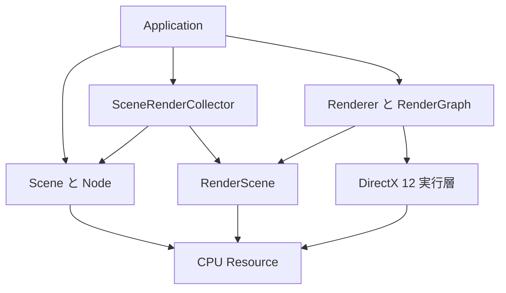

# エンジンの構造と責務

> 状態：実装前の初期設計。ここに記載するクラス名・配置は実装契約の案であり、動作確認済みコードを意味しない。変更は [DECISIONS.md](DECISIONS.md) に理由を残す。

## 目次

- [1. 設計の中心](#1-設計の中心)
- [2. 設計案の比較](#2-設計案の比較)
- [3. モジュールと配置](#3-モジュールと配置)
- [4. Node・Scene・Resource](#4-nodesceneresource)
- [5. 所有権と寿命](#5-所有権と寿命)
- [6. 更新と描画の境界](#6-更新と描画の境界)
- [7. 外部ライブラリの境界](#7-外部ライブラリの境界)
- [8. 段階導入と設計レビュー](#8-段階導入と設計レビュー)
- [9. 一次資料](#9-一次資料)

## 1. 設計の中心

学生が「何を変更したければ、どのファイルを読むのか」を説明できる構造を採る。優先順位は **理解・可読性 → 拡張性 → 教材化 → 機能・効率** とする。

Godot の Node・Scene・Resource を参考にするが、その API、ファイル形式、エディタ、内部実装の互換性は目標に含めない。Node は場面中の役者、Scene は役者をまとめる舞台、Resource は複数の役者が利用する素材、と説明する。[Godot の概念資料](https://docs.godotengine.org/en/stable/getting_started/introduction/key_concepts_overview.html) を用語の参考にする。

初期版は「少数の Node 派生型 + 値として保持する小さな機能データ」を基本とする。深い継承、汎用的な Component 登録機構、ECS、複数描画 API に対応する抽象層を同時に導入しない。必要性が実例で確認できた時点で比較・追加する。

## 2. 設計案の比較

### 2.1 ゲームオブジェクト

| 案 | 長所 | 短所 | 授業での難易度 | 判断 |
| --- | --- | --- | --- | --- |
| Node 派生型 + 小さなデータの合成 | 継承の既習知識を使える。階層をデバッガで追える | 機能の全組合せを派生型にすると増殖する | 低〜中 | **初期採用**。派生は役割の異なる少数の型に限定 |
| Node + 任意追加の Component | 機能を組み替えやすい | 所有・検索・更新順・依存関係の説明が増える | 中〜高 | 固定的な組合せでは不足した場合に再検討 |
| ECS | 同じ種類の大量データをまとめやすい | エンティティ ID とデータ配列、問い合わせを先に理解する必要がある | 高 | 発展教材として分離 |

「拡張性」を理由に、空のインターフェースや未使用の管理クラスを先に増やさない。新しい抽象化には、現在の具体的な利用箇所を少なくとも示す。

### 2.2 描画の構造

| 案 | 長所 | 短所 | 授業での難易度 | 判断 |
| --- | --- | --- | --- | --- |
| Node が直接 DirectX 12 コマンドを記録 | 最初の呼出し経路が短い | Scene と GPU 状態・寿命が密結合する | 最初は低、拡張後は高 | 三角形までの独立サンプルに限定 |
| Scene から描画データを集め、Renderer が描く | CPU 側の構造と GPU 処理を別々に学べる | 描画データへの変換が一段増える | 中 | **エンジンとしての初期採用** |
| 汎用 RHI と複数バックエンド | 複数 API に展開しやすい | DirectX 12 を学ぶ前に抽象 API を学ぶ必要がある | 高 | 対象 API を増やす要求が出るまで延期 |

## 3. モジュールと配置

以下は実装時の配置案。M00〜M03で全ディレクトリを空のまま量産せず、担当機能を導入する段階で作る。

| 配置案 | 主な責務 | 代表的な型の候補 | 知ってよいもの |
| --- | --- | --- | --- |
| `engine/core/` | ログ、時刻、識別子、共通エラー | `Logger`, `FrameClock` | 標準ライブラリ |
| `engine/platform/win32/` | ウィンドウ、メッセージ、入力の収集 | `Window`, `InputState` | Win32、Core |
| `engine/scene/` | 木構造、更新、変換、Scene の切替 | `Scene`, `Node`, `Node3D` | Core、CPU 資産、数学 |
| `engine/resource/` | CPU 側の素材データ、読み込み、キャッシュ | `MeshResource`, `MaterialResource`, `TextureResource` | Core、ローダー |
| `engine/render/` | 描画データ、描画方式、Scene との接続 | `RenderScene`, `SceneRenderCollector`, `Renderer` | Scene は収集担当だけが参照 |
| `engine/render/d3d12/` | GPU オブジェクト、転送、同期、解放 | `Dx12Device`, `FrameContext`, `RenderAssetCache` | DirectX 12、描画データ、CPU 資産 |
| `engine/render/graph/` | パス宣言、検証、状態遷移の計画 | `RenderGraph`, `PassContext` | 計画・検証は標準C++のみ。実行時にDX12層へ接続 |
| `engine/integrations/{imgui,lua,audio,effekseer}/` | ImGui、Lua、音声、Effekseer の接続 | 各ライブラリの Adapter | 必要な公開 API のみ |
| `samples/{clear_window,triangle,scene_viewer,...}/` | 起動、サービスの生成、実験 Scene | `Application` | 上記モジュールを組み立てる |
| `shaders/` | Unlit・PBR・合成用 HLSL | 頂点／ピクセルシェーダ | CPU とのバインド契約 |
| `tests/` | CPU ロジックの契約確認（Linux でも実行可能にする） | 所有、ハンドル、Graph 検証 | テスト対象の公開 API |
| `lessons/{students,teachers}/` | 確認済みコードに対応する授業原稿 | 章、演習、解答 | 対応する実装と検証記録 |

矢印は「左側が右側を使う」を表す。描画データを集める橋渡し部分を除き、描画層から Scene のノードを直接操作しない。



最初から別 DLL にする必要はない。CMake のターゲットとヘッダの依存関係で境界を示し、単一プロセス内で動かす。共通ヘッダに Win32・D3D12・ImGui・sol2 の全ヘッダを集めない。

RenderGraphの宣言・順序検証は、単純な用途の列挙値とhandleを扱うCPU部分へ分離し、D3D12ヘッダに依存させない。D3D12のstate値への変換、barrier記録、GPU実体への解決だけをWindows側に置く。これは複数API対応のRHIではなく、CPU契約をテスト可能にする最小の境界である。

## 4. Node・Scene・Resource

### 4.1 最小の型

| 型 | 持つもの | 持たないもの |
| --- | --- | --- |
| `Node` | 名前、親子関係、Scene 内 ID、有効状態、更新入口 | GPU コマンド、汎用サービス検索 |
| `Node3D` | 位置・回転・拡縮をまとめた `Transform`、計算済み world 行列 | Mesh の頂点配列そのもの |
| `MeshInstanceNode` | Mesh と Material への共有参照 | Mesh の複製、DirectX 12 の初期化 |
| `CameraNode` | 投影条件、カメラ変換 | ウィンドウ所有権、Present 呼出し |
| `LightNode` | 光の色、強度、種類 | PBR の描画処理そのもの |
| `Scene` | ルート Node、Node レジストリ、保留中の木構造変更 | DirectX 12 のリソース状態管理 |
| `MeshResource` | 頂点・インデックス等の CPU データ | Scene 上の位置 |
| `MaterialResource` | 描画モード、色・質感、Texture 参照 | 特定 Node の world 行列 |

`Node -> Node3D -> MeshInstanceNode` 程度の浅い階層を上限の目安にする。`PlayerMeshAudioScriptNode` のような組合せ別クラスを増やさず、必要な振る舞いをゲーム側 Node や小さな保持データへ分ける。

`Scene` は実行中のインスタンスを意味する。将来のシーン保存データや再利用可能な雛形は別の概念とし、M05で汎用シリアライズを必須にしない。初期 Scene は C++ の生成関数で構築できればよい。

### 4.2 Transform の契約

この節の3D機能はM06で導入する。M05はNodeの所有・更新・handle・Resource共有までを実装し、DirectXMathや完成した3D変換を前提にしない。

- 位置・拡縮・回転を局所座標で保持し、回転は Quaternion を用いる。教材ではまず位置だけ、次に回転、最後に親子変換を導入する。
- 座標・行列規約は [RENDERING.md](RENDERING.md) の表を正とする。行ベクトルでは `world = local * parentWorld` とする。
- Scene の専用走査で親から子へ world 行列を更新する。途中の通常 `Node` は親の変換をそのまま下へ渡し、最も近い `Node3D` 祖先の変換を継承する。
- 最初は全 Node3D の行列を毎フレーム再計算してよい。変更フラグによる部分更新は、測定して必要性が分かってから導入する。
- `Node3D` のメソッド内で別 Node の world 行列を必要とするときは、そのフレームの「確定前／確定後」を区別する。更新中は前フレームの確定値を参照し、最終描画値は変換走査後に読む。

## 5. 所有権と寿命

**所有権**は「誰が最後に片付けるか」、**参照**は「誰が利用できるか」を意味する。この二つを各メンバで説明できるようにする。

| 対象 | 所有・参照方法 | 解放または無効化の条件 |
| --- | --- | --- |
| Scene のルート | `std::unique_ptr<Node>` | Scene 終了時 |
| 親から子 | `std::vector<std::unique_ptr<Node>>` | 保留削除の適用時、親の破棄時 |
| 子から親 | 非所有の `Node*` | 木の操作中に更新。フレームを跨いで外部保存しない |
| Lua、インスペクタ、ゲームの他 Node | `NodeHandle` | Scene ID・slot・generation の照合失敗、または削除予定 |
| Mesh／Material／Texture | 原則 `std::shared_ptr<const T>` | 最後の利用者とキャッシュが手放したとき |
| Resource キャッシュ | 原則 `std::weak_ptr<const T>` | 利用者がなくなれば再読込可能 |
| D3D12 COM オブジェクト | `Microsoft::WRL::ComPtr<T>` | GPU 利用完了を確認してから参照を手放す |
| GPU が参照する一時データ・descriptor 領域 | `FrameContext` または fence 付き保留リスト | 対応する fence 値の完了後 |

Godot の Node/Resource の役割を参考にする一方、C++ 版の所有方式はこのプロジェクトで明示的に決める。[Node の階層と削除](https://docs.godotengine.org/en/stable/tutorials/scripting/nodes_and_scene_instances.html)、[Resource の再利用](https://docs.godotengine.org/en/stable/tutorials/scripting/resources.html) をそのまま C++ の所有モデルと同一視しない。

### 5.1 NodeHandle

次は C++20 の**設計用の宣言例**であり、まだレジストリ実装・コンパイル確認は行っていない。

```cpp
#include <cstdint>
#include <limits>

struct NodeHandle final {
    std::uint64_t sceneId = 0; // Scene が変わったことも識別する。
    std::uint32_t slot = std::numeric_limits<std::uint32_t>::max();
    std::uint32_t generation = 0; // 同じ slot の再利用を見分ける。
    bool operator==(const NodeHandle&) const = default;
};
```

- `Scene::Resolve(handle)` は Scene ID、slot 範囲、generation、有効状態を確認し、失敗時は `nullptr` を返す。返されたポインタは直後の同期処理だけで借りる。
- Scene ID は実行中に再利用しない。slot の generation が上限に達したら、その slot を再利用対象から外す。無言の巻き戻りを許さない。
- ID にポインタ値を流用しない。メモリアドレスの再利用を「同じ Node」と判断してしまうためである。
- Lua に `Node*` や `std::shared_ptr<Node>` を直接公開しない。NodeHandle を保持する窓口を用意し、各操作で Scene に照会する。
- Scene 自体が終了した場合の照会は、現在の Scene を管理する側で拒否する。失効済み Scene のポインタを NodeHandle と一緒に保存しない。

### 5.2 木構造の変更

`Update()` の途中で子配列を直接変更すると、走査位置や参照が壊れる。そのため、追加・削除・付け替えは Scene に依頼し、**更新走査の終了後、Transform 計算の前**に適用する。

1. `QueueDestroy(handle)` は対象の部分木を削除予定にし、以後の `Resolve` とそのフレームの更新対象から外す。
2. 現在実行中のメソッドは戻るまでオブジェクトが存続する。要求時点で `delete this` を行わない。
3. 適用時にレジストリを無効化してから所有 `unique_ptr` を破棄する。
4. 追加 Node は適用完了後に有効な NodeHandle を得る。即時に戻り値が必要な API は、予約 ID と有効な NodeHandle を区別して別途設計する。
5. 付け替えは同一 Scene 内に限定し、自分自身や自分の子孫を親にする要求を拒否する。初期版は局所 Transform を保持する。world 位置保持を暗黙に行わない。
6. 親削除と子追加が衝突したときは、削除を優先し追加を失敗として返す。曖昧な順序で黙って消さない。

### 5.3 CPU Resource と GPU 資産

`shared_ptr` の参照数は CPU の利用者数であり、GPU の作業完了を表さない。`ComPtr` だけでは、進行中の GPU 処理に対する寿命は守れない。[Microsoft の CPU/GPU 同期説明](https://learn.microsoft.com/en-us/windows/win32/direct3d12/porting-from-direct3d-11-to-direct3d-12) に従い、fence で完了を確認する。

- CPU Resource は D3D12 型を公開しない。`RenderAssetCache` が Resource ID と GPU バッファ・Texture の対応を保持する。
- Draw に使った GPU 資産は、そのフレームの `FrameContext` に保持し、送信後の fence 完了まで解放しない。upload 用の一時バッファも同様とする。
- Material の共有編集は全利用者へ影響するため、初期版は読み取り専用として扱う。インスペクタで特定個体だけ変更するときは、明示的に複製して差し替える。
- Texture の差し替えは「CPU の参照変更」と「旧 GPU Texture／descriptor の回収」を別に処理する。後者は GPU 完了後まで遅らせる。

## 6. 更新と描画の境界

通常フレームの順序を次に固定する。Scene の削除タイミングと GPU 完了待ちは別の境界である。

1. Win32 のメッセージを処理し、入力状態を取り込む。
2. 選択した時間刻みでゲーム・Lua・Node を更新する。木構造変更は保留する。
3. 保留した追加・削除・付け替えを適用する。
4. 親から子へ Transform を確定する。
5. `SceneRenderCollector` が `RenderScene` を作る。内容は world 行列、カメラ、ライト、Mesh／Material 参照とする。
6. Renderer が GPU 資産と FrameContext を準備し、RenderGraph を検証・実行する。
7. Present と fence の記録を行い、完了済みの一時資産を回収する。

`RenderScene` はそのフレームの描画に必要な値と共有資産を保持する。GPU 実行が Node のポインタへ戻って情報を読む設計にしない。これにより Scene 切替時の CPU の破棄と、前 Scene の GPU 描画完了を分けて扱える。

初期版は単一スレッドでよい。RenderScene を作るのは責務を分けるためであり、並列描画を最初から実装するためではない。

## 7. 外部ライブラリの境界

| 統合 | 導入段階 | 境界の契約 |
| --- | --- | --- |
| ImGui | M09 | インスペクタは NodeHandle で対象を識別。入力の取り込み可否をゲーム側へ返す。描画は独立パス |
| Lua／sol2 等 | M10 | 公開する型・関数を限定。NodeHandle 経由で操作。スクリプトのエラーをファイル名・行付きで報告 |
| XAudio2 | M11 | Scene 内の再生要求と音声デバイス・voice の寿命を分離。API が求める音声バッファ寿命を守る |
| CRI Middleware | 将来の選択肢 | 利用条件と配布条件を確かめてから Adapter を追加。XAudio2 の初期到達点を妨げない |
| Effekseer | M12 | ゲーム側は effect 資産と再生 handle を使用。描画・descriptor・command list の責務は Adapter 内へ限定 |

「全サービスをどこからでも取得できる Singleton」を基盤にしない。`Application` がサービスを生成し、必要な相手へコンストラクタまたは明示的な引数で渡す。終了時は新しい更新・送信を停止して GPU 完了を待ち、その後に利用側と統合機能、GPU 資産、デバイス／ウィンドウの順で破棄する。ImGui／Effekseer が持つ GPU 資産も完了待ちより先に解放しない。音声 callback とバッファには別途その API の停止・完了条件を適用する。

外部ライブラリの具体的なバージョン、API、再配布条件は [DEPENDENCIES.md](DEPENDENCIES.md) を確認する。本文では組合せの互換性を検証済みとは扱わない。

## 8. 段階導入と設計レビュー

| 段階 | 構造として確認すること |
| --- | --- |
| M00〜M04 | ウィンドウ、GPU 初期化、描画、同期の責務を追える。未使用の Scene 抽象を要求しない |
| M05 | Node の親子所有、削除予定、失効 handle、Scene 切替を CPU で確認できる |
| M06 | 同じ Mesh を複数 Node が共有し、それぞれ異なる world 行列で描画できる |
| M07 | Node を変更せずに描画パスとリソース遷移を説明できる |
| M08 | Material の PBR／Unlit 切替が Scene 所有規則を変えない |
| M09〜M12 | 外部 API の型が不要なモジュールへ漏れていない |
| M13 | 学生が入力→Node 更新→描画データ→GPU→表示の経路を辿れる |

レビューでは、所有者、参照の有効期間、呼出し順、失敗時の報告先を一緒に確認する。クラス数やデザインパターン名の多さを完成度の指標にしない。詳細な完了条件は [ROADMAP.md](ROADMAP.md) と [VALIDATION.md](VALIDATION.md) に従う。

## 9. 一次資料

参照確認日：2026-11-25。Godot の記述は設計概念の参考であり、本エンジンの実装仕様は本文の決定を優先する。

- [Godot — Key concepts](https://docs.godotengine.org/en/stable/getting_started/introduction/key_concepts_overview.html)
- [Godot — Nodes and scene instances](https://docs.godotengine.org/en/stable/tutorials/scripting/nodes_and_scene_instances.html)
- [Godot — Resources](https://docs.godotengine.org/en/stable/tutorials/scripting/resources.html)
- [Microsoft — Porting from Direct3D 11 to Direct3D 12：CPU/GPU synchronization](https://learn.microsoft.com/en-us/windows/win32/direct3d12/porting-from-direct3d-11-to-direct3d-12)
- [Microsoft — DirectXMath matrix convention](https://learn.microsoft.com/en-us/windows/win32/dxmath/pg-xnamath-getting-started)
