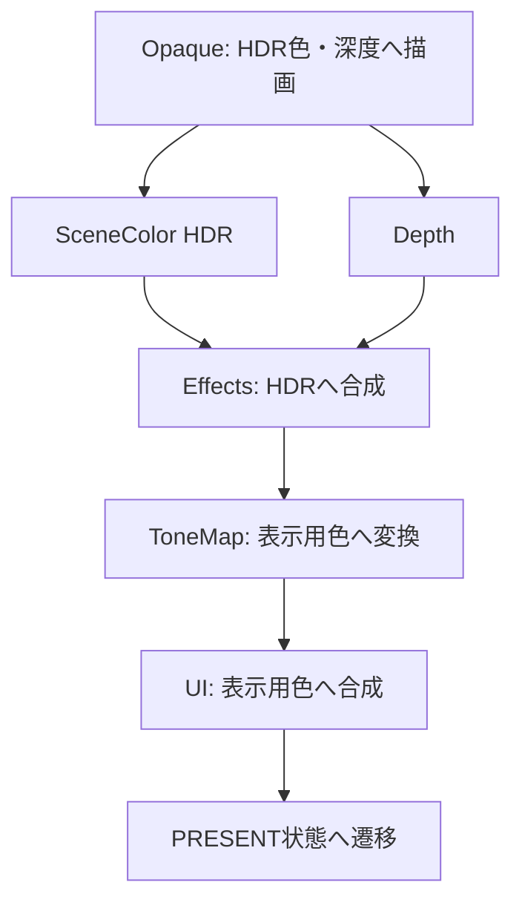

# DirectX 12 描画基盤と簡易 RenderGraph

> 直接描画をM02〜M04で段階的に実装し、M07で同じ処理を簡易 RenderGraph に移す。各節に記載する型の候補と実装済みAPIの対応は、進捗記録で確認する。 [STATUS.md](STATUS.md)

## 目次

- [1. 最初に揃える用語](#1-最初に揃える用語)
- [2. 座標・色・シェーダの契約](#2-座標色シェーダの契約)
- [3. DirectX 12 の責務](#3-directx-12-の責務)
- [4. フレーム同期と寿命](#4-フレーム同期と寿命)
- [5. 簡易 RenderGraph](#5-簡易-rendergraph)
- [6. Unlit と PBR](#6-unlit-と-pbr)
- [7. リサイズ・終了・障害](#7-リサイズ終了障害)
- [8. デバッグと段階別検証](#8-デバッグと段階別検証)
- [9. 一次資料](#9-一次資料)

## 1. 最初に揃える用語

| 用語 | 一言での説明 | このエンジンでの役割 |
| --- | --- | --- |
| Command queue | GPU への作業依頼の列 | 初期版は Direct queue を1本使う |
| Command list | GPU に渡す手順書 | 描画やコピーの命令を記録する |
| Command allocator | 手順書の記録に使う保管場所 | GPU が使い終わってから再利用する |
| Fence | GPU がどこまで終えたかを示す番号札 | CPU の上書き・再利用・解放の可否を判断する |
| Resource barrier | GPU 資産の使い道を切り替える境目 | 書き込み先から読み取り元へ移る等の順序を示す |
| Descriptor | GPU 資産の見方を書いた案内札 | Texture として読む／画面として書く等を指定する |
| Descriptor heap | 案内札を並べた領域 | CPU 用とシェーダから見える領域を分ける |
| Root signature | シェーダに渡す引数の配置図 | CBV・SRV・Sampler と HLSL register の対応を定める |
| Pipeline state object（PSO） | 描画方法をまとめた設定 | シェーダ、頂点形式、深度、blend 等を組にする |
| RenderGraph | 描画工程と素材の読み書きの一覧 | 処理順とバリアを検証してから実行する |

**Fence と barrier は別の問題を扱う。** Fence は GPU 完了の確認、barrier は GPU 処理間での資産の使い方の調整である。片方を入れても、もう片方の責務は消えない。[MS 同期説明](https://learn.microsoft.com/en-us/windows/win32/direct3d12/porting-from-direct3d-11-to-direct3d-12)、[MS resource barrier](https://learn.microsoft.com/en-us/windows/win32/direct3d12/using-resource-barriers-to-synchronize-resource-states-in-direct3d-12) を参照する。

## 2. 座標・色・シェーダの契約

### 2.1 座標と行列

| 項目 | 初期版の規則 |
| --- | --- |
| 空間 | 左手系、右が +X、上が +Y、前が +Z。長さは原則メートル |
| 回転 | 内部はQuaternion、角度を受け渡す数学APIはラジアン。教材やUIで度を使う場合は単位を表示し、境界でラジアンへ変換 |
| CPU の行列 | DirectXMath、行ベクトル、行優先保存 |
| シェーダの行列 | `row_major float4x4` を明記し、`mul(vector, matrix)` を使用 |
| 合成順 | `world = local * parentWorld`、`clip = position * world * view * projection` |
| CPU→GPU 転送 | 上記規約の行列をそのまま格納。無条件の転置を追加しない |
| 深度 | NDC（射影後の正規化座標）の z は 0〜1。通常 Z、clear は1、比較は `LESS_EQUAL` を初期値にする |
| カリング | 頂点の並び順と `FrontCounterClockwise` をサンプルで固定。座標系だけから暗黙に推測しない |
| テクスチャのUV | 初期標準は左上が(0,0)、右へu、下へvが増える。画像・モデルの取込境界で統一し、各シェーダへ場当たり的な反転を入れない |

DirectXMath の行ベクトル規約と HLSL の既定の保存規約は同じとは限らないため、`row_major` を明記する。[DirectXMath](https://learn.microsoft.com/en-us/windows/win32/dxmath/pg-xnamath-getting-started)、[HLSL mul](https://learn.microsoft.com/en-us/windows/win32/direct3dhlsl/dx-graphics-hlsl-mul) を参照する。

外部モデルが異なる座標系を使う場合は、読み込み境界で位置・法線・接線・頂点の並びを一貫して変換する。glTF 対応、Reverse-Z、独自数学ライブラリは初期到達点に含めない。

### 2.2 CPU と HLSL のバインド

- バインド表を各シェーダの隣に置く。最低限、`b/t/u/s` 番号、register space、可視ステージ、C++ 構造体、サイズ・アラインメントを記載する。
- Root signature と HLSL の register 宣言が一致することをレビューする。PSO を作るだけでは入力レイアウトや資産の中身までは正しくならない。
- Constant buffer の配置とサイズは D3D12 の要件に合わせる。CBV のサイズ・オフセットは256バイト単位で扱い、HLSL 内部の packing（各メンバの詰め方）規則とは分けて説明する。[定数と配置](https://learn.microsoft.com/en-us/windows/win32/direct3d12/constants)、[CBVの作成例](https://learn.microsoft.com/en-us/windows/win32/direct3d12/creating-descriptors) を参照する。
- C++ の `bool`、暗黙 padding、`float3` の配置を無検証で HLSL に渡さない。整数フラグと明示 padding を使用し、`sizeof`・`offsetof` を確認する。
- DXC のバージョン、target profile、include 検索パス、debug／release オプションを記録する。コンパイル失敗を空のバイトコードで続行しない。

## 3. DirectX 12 の責務

### 3.1 クラスの候補

| 型 | 役割 | 分離する理由 |
| --- | --- | --- |
| `Dx12Device` | adapter の選択、device、debug 設定 | GPU の初期化を描画ループから探しやすくする |
| `GraphicsQueue` | Direct queue、fence、送信、完了待ち | CPU/GPU の時間のずれを一箇所で管理する |
| `SwapChain` | back buffer、Present、リサイズ | ウィンドウサイズの変化を扱う |
| `FrameContext` | allocator、upload（CPUからGPUへ渡す）領域、完了番号、保持資産 | 同じフレームの再利用条件をまとめる |
| `DescriptorAllocator` | descriptor の確保・回収 | 案内札の上書き事故を防ぐ |
| `GpuBuffer`／`GpuTexture` | GPU 資産、説明用の名前、状態 | 所有と状態を別々の場所で二重管理しない |
| `RenderAssetCache` | CPU Resource と GPU 資産の対応 | Node に DirectX 12 型を持ち込まない |

M02でこの全クラスを必須にしない。まず処理の順序を見えるようにし、M04までに寿命と同期の責務を分ける。詳細なモジュール境界は [ARCHITECTURE.md](ARCHITECTURE.md) に従う。

M02では `ClearRenderer` がデバイス、direct queue（描画命令をGPUへ渡す列）、swap chain（画面に表示するバッファの切替）、描画先を指すRTV、GPUの完了番号を示すフェンスを所有する。`Draw` は描画先を `PRESENT` から `RENDER_TARGET` に切り替えて色を塗り、`PRESENT` に戻して表示に渡す。表示への送信後、フェンスでGPU完了を確認してから、次の呼び出しで命令の記録領域を再利用する。 [Microsoftの初期化と描画の流れ](https://learn.microsoft.com/en-us/windows/win32/direct3d12/creating-a-basic-direct3d-12-component)

背景色は表示用の値として `R8G8B8A8_UNORM` のRTVに書く。サンプルの `--warm` は、同じ描画手順で渡す色だけを変更する。

### 3.2 Descriptor の区別

| 種類 | 用途 | 初期版の扱い |
| --- | --- | --- |
| RTV | 描画先の色バッファ | CPU descriptor heap。back buffer／HDR Texture 用 |
| DSV | 深度バッファ | CPU descriptor heap。depth Texture 用 |
| CBV | 定数データ | root CBV（定数のGPUアドレスを直接渡す方式）またはシェーダ可視 heap。採用方式を固定 |
| SRV | シェーダからの読み取り | シェーダ可視 CBV/SRV/UAV heap |
| UAV | シェーダからの汎用読み書き | 初期 RenderGraph では未対応として明示的に拒否 |
| Sampler | Texture の補間・繰返し等 | 初期版は static sampler（固定の補間設定）を優先 |

シェーダ可視 heap の参照中領域は、GPU 完了前に上書き・再利用しない。RTV／DSV には同一のハードウェア規則がそのまま適用されるわけではないが、この教材では関連資産の再生成時に GPU 完了を待つ統一手順を採る。[Descriptor tables](https://learn.microsoft.com/en-us/windows/win32/direct3d12/advanced-use-of-descriptor-tables)、[resource binding](https://learn.microsoft.com/en-us/windows/win32/direct3d12/resource-binding-flow-of-control) を参照する。

Root signature 1.1 の static descriptor 条件を使う場合は、記録中からの変更制約も確認する。初期設計の単純な規則は「描画の記録開始から、その送信の完了まで当該 descriptor を変更しない」とする。

## 4. フレーム同期と寿命

### 4.1 二つの段階

| 方式 | 長所 | 短所 | 授業での難易度 | 採用段階 |
| --- | --- | --- | --- | --- |
| 毎フレーム GPU 完了待ち | 手順と寿命が説明しやすい | CPU と GPU が重なって働きにくい | 低 | M02〜M03の最初の実装 |
| フレームごとの資産と fence | 使用中の領域を避けて CPU が先へ進める | どの番号に何を保持したかが増える | 中 | **M04以降の基本方式** |
| 高度なリング・複数 queue・細粒度回収 | 効率を追求できる | 説明と不具合解析が複雑になる | 高 | 発展課題として延期 |

### 4.2 M04以降の手順

初期値は back buffer 2枚、FrameContext 2組とする。ただし「back buffer 番号」と「自分で確保した FrameContext 番号」は概念が異なるため、現在の back buffer は毎回 `GetCurrentBackBufferIndex()` で取得する。

1. 今回使う FrameContext の `lastSubmittedFence` を確認する。
2. 未完了なら、その番号まで CPU を待機させる。固定時間の sleep を同期に代用しない。
3. 完了済みなら allocator を `Reset` し、そのフレームの upload・一時 descriptor・保持資産を再利用する。
4. command list に必要な描画を記録する。最後に back buffer の `RENDER_TARGET -> PRESENT` barrier も記録してから、command list を閉じる。M07以降ではこの終端barrierをGraphのexport処理が記録する。
5. 閉じた command list を Direct queue へ送信し、その後に Present を呼ぶ。閉じた後の command list にbarrierを追加しない。
6. 単調増加する fence 値を queue に Signal し、その値を FrameContext に保存する。
7. その送信で使った資産を、完了確認まで FrameContext に保持する。

allocator の Reset は、それを使った GPU コマンドが完了した後に限る。[ID3D12CommandAllocator::Reset](https://learn.microsoft.com/en-us/windows/win32/api/d3d12/nf-d3d12-id3d12commandallocator-reset) を根拠にする。command list 自体の Reset 条件と allocator の Reset 条件を混同しない。

定数バッファのデータを全フレームで1領域だけ共有し、毎フレーム上書きしてはいけない。各 FrameContext の upload 領域へ書き込み、GPU に渡した範囲を完了まで保持する。Texture 転送用 upload buffer もコピー記録直後に解放しない。

## 5. 簡易 RenderGraph

### 5.1 採用する範囲

**登録順で実行し、読み書き宣言からバリアを用意する小さな RenderGraph** を採る。グラフは1フレームの描画計画であり、Scene の親子関係とは別物である。

| 案 | 長所 | 短所 | 教育難易度 | 判断 |
| --- | --- | --- | --- | --- |
| 手書き順序・手書きバリア | API を直接理解しやすい | パスが増えると漏れが出やすい | 低 | M02〜M06で使う |
| 登録順固定 + 読み書き検証 + バリア計画 | 図と実行順が一致する | 自動並べ替えの自由度はない | 中 | **M07の採用案** |
| トポロジカルソート + alias + 複数 queue | 大規模な最適化へ進める | 資産寿命と順序の理解が難しい | 高 | 初期版の対象外 |

M07の機能は、単一 Direct queue、単一 command list、Texture 全体単位の状態、graphics pass、登録順実行に限定する。subresource（mipや配列slice等の部分領域）ごとの追跡、UAV、async compute、transient alias、pass culling、並列記録は対応済みのふりをせず明示的な対象外とする。

### 5.2 宣言と版

パスは、使用する資産・使用方法・新しく作る内容の版を宣言する。版とは「同じ紙に書く前と後を区別する番号」であり、GPU メモリを毎回複製する意味ではない。

- `CreateTexture` は資産の説明を登録する。この時点では内容は未初期化。
- `ImportTexture` は外部資産、初期状態、初期内容の有効性、要求する最終状態を受け取る。
- 最初の書き込みは clear または全ピクセルを定義する full overwrite とする。単に数個の三角形を描くことは full overwrite とみなさない。
- `Load` して続けて描く attachment は、以前の有効な版を必要とする。パスは新しい版を発行する。
- 読み取りは、**それ以前に登録された書き手**または有効な外部内容の版を参照する。
- 一つの版の writer は一つに限定する。2回目以降の書き込みは最新の版を入力に取り、新しい版を発行する。内容を破棄する clear でも、順序上の最新の版とのつながりは保持する。
- 新しい版への書き込み後に古い版を読む要求は拒否する。初期実装では同じ物理 Texture を使うため、古い内容の保存は保証しない。

公開 API 名は実装時に確定する。次は C++20 で表現することを想定した**M08・M09導入後の擬似コード**であり、コンパイル可能な完成コードではない。M07ではUnlitのオフスクリーン描画と単純な最終合成の2パスに留め、HDRのtonemapとUIはそれぞれM08・M09で追加する。

```cpp
// 物理 Texture と、その内容の版を分けて考えるための設計例。
auto color = graph.CreateTexture("SceneColor", hdrDescription);
auto depth = graph.CreateTexture("Depth", depthDescription);
auto back  = graph.ImportTexture("BackBuffer", externalBackBuffer,
                                PresentState, /*contentsValid=*/false,
                                PresentState);

auto opaque = graph.AddGraphicsPass("Opaque");
auto colorV1 = opaque.WriteColor(color, ClearColor);
auto depthV1 = opaque.WriteDepth(depth, ClearDepth);
opaque.Execute(recordOpaque);

auto tone = graph.AddGraphicsPass("ToneMap");
tone.ReadTexture(colorV1);
auto backV1 = tone.WriteColor(back, FullOverwrite);
tone.Execute(recordToneMap);

// ImGui 導入後。attachment の Load は前の版の保持を要求する。
auto ui = graph.AddGraphicsPass("UI");
auto backV2 = ui.LoadAndWriteColor(backV1);
ui.Execute(recordUi);

graph.Compile(); // 検証と状態遷移計画。失敗したら GPU へ送らない。
graph.Execute(frameContext);
```

`depthV1` や `backV2` を後から読み取るパスがなくても、初期 Graph は描画パスを削除しない。使われない変数の警告は実際の API 設計に合わせて解消する。擬似 API をライブラリに存在する関数として教材へ転載しない。

### 5.3 Compile の検証

| 検証項目 | 拒否する例 | エラーに含める情報 |
| --- | --- | --- |
| 未初期化読み取り | 作成しただけの HDR Texture を読む | パス名、資産名、必要な版 |
| 前方参照 | 後で書くパスの出力を先に読む | 読み手・書き手の登録番号 |
| 古い版の読み取り | v2で上書きした後にv1を読む | 最終有効版と要求版 |
| 同一パスの競合 | 同じ Texture を SRV と RTV で同時利用 | 競合する使用方法 |
| 不正な Load | 未初期化 attachment の内容を保持する | clear または先行 writer が必要な理由 |
| 不正な型・形式 | depth 用途へ color format を渡す | 要求した用途と資産の説明 |
| 非対応機能 | UAV、別 queue、subresource 指定 | 現在サポートする範囲 |
| 失効した handle | 前フレームの Graph 資産を再利用 | Graph 世代と資産 ID |

attachment の `LoadAndWrite` は許可した一つの用途として扱い、SRV と RTV の同時使用とは区別する。全依存を「登録番号が小さい writer → 大きい reader」に限定するため、循環を含む要求は前方参照として拒否できる。この仕様を「任意のグラフを自動ソートする」と説明しない。

最初の実装では、フレームごとに小さな配列を登録順走査してよい。汎用グラフライブラリや高度なテンプレート DSL を導入しない。

### 5.4 バリア計画と外部資産

- Compile は全宣言を検証してから、各資産の初期状態→各パスの要求状態→最終状態を計画する。
- `RENDER_TARGET`、`DEPTH_WRITE`、`PIXEL_SHADER_RESOURCE` 等への遷移を、パス境界で挿入する。状態が同じ場合は無意味な transition を増やさない。
- 初期版は explicit transition を優先する。ただし buffer の promotion／decay や upload heap の固定的な状態など、API の規則を無視した状態を発明しない。Graph 対象はまず render target／depth Texture に絞る。
- back buffer は毎フレーム外部から取り込み、初期と終端を `PRESENT` とする。終了時の `RENDER_TARGET -> PRESENT` は Graph の export 処理が担当する。
- GPU オブジェクトの実体は Renderer／cache が所有する。Graph の handle はフレーム内の参照であり、Graph の終了だけで GPU 使用中 Texture を解放しない。
- 永続 Texture の状態は実行層の資産レコードを唯一の情報源とする。Graph と別の renderer がそれぞれ「現在の状態」を書き換えない。
- Compile 失敗や記録失敗時には予定状態を確定状態として扱わない。送信が成功した状態遷移のみを後続の計画へ反映する。device lost 時は通常運転を止める。
- pass callback がGraph管理対象のTextureを宣言せずに使うことを禁止する。Graph内で共有する出力・深度・パス間のサンプリング対象はimportまたはcreateし、使用と必要状態を宣言する。
- VB/IB/定数データ、転送済みの素材Texture、Adapter内部の資産は、初期Graphの追跡対象外にできる。その場合はRenderer/Adapterが状態・binding・GPU寿命を保証し、Graphが完全に検証できるとは説明しない。共有出力を私有資産として扱い、二重の状態管理をすることは禁止する。

描画の順序例を示す。UI は M09、Effekseer は M12で追加する。



Effects パスの深度読み取りや blend の扱いは、選択した Effekseer の実 API を確認して決める。図だけを根拠に対応 API が存在すると仮定しない。

## 6. Unlit と PBR

### 6.1 描画モード

Material は `Unlit`／`PBR` を明示的に選べる。M06は Unlit のみ完成させ、未実装の PBR を選択できる UI を出さない。M08以降の製品上の既定は PBR とし、初学者向けサンプルは学習順序のため Unlit を明示する。

Unlit は照明を計算せず、base color と Texture を表示する。Unlit でも Texture の色空間処理は必要である。Material のモード変更は PSO とシェーダ選択へ反映し、Node の種類や所有方法は変えない。

### 6.2 PBR の最初の範囲

PBR は「光の反射を一定の物理的な約束で計算する方式」と説明する。初期版は metallic-roughness による不透明な直接照明に限定する。

- 入力：base color、metallic、roughness、normal、カメラ位置、まず1個の方向ライト。
- 分布：GGX。幾何項：Smith の GGX。フレネル：Schlick 近似。これらの名称は、微小面の傾き／相互の遮蔽／見る角度による反射、と言い換える。
- `alpha = roughness * roughness` を採用する。数式上の alpha と UI の roughness を混同しない。
- 極小 roughness、半角ベクトル、分母に対する数値上の下限を決め、NaN を防ぐ。
- 非金属の初期 `F0` は0.04、金属では base color を用いる設計とし、選んだ式と近似の出典を実装の隣に記載する。
- diffuse は金属で減らし、specular と合わせてエネルギーを無条件に加算しない。
- 法線は単位化し、非一様拡縮に対して inverse-transpose の法線行列を使用する。M08前半は頂点法線、normal map は接空間を説明してから追加する。
- **IBL、影、透過、clearcoat、anisotropy、複数散乱は初期 PBR に未実装**と表示する。直接光しかなければ暗い面が暗くなることを不具合と断定しない。

材質の入力の参考は [Khronos glTF 2.0 metallic-roughness](https://registry.khronos.org/glTF/specs/2.0/glTF-2.0.html#metallic-roughness-material) とする。glTF の全仕様への適合やモデル読み込み機能は、この参照だけで保証されるものではない。

### 6.3 色空間と表示

| データ・工程 | 規則 |
| --- | --- |
| base color／emissive Texture のRGB | sRGB として読み、サンプリング時に linear へ変換 |
| metallic／roughness／AO／normal Texture | データ値。sRGB 変換しない |
| alpha | 色のRGBと別に扱う。sRGB Texture でもalphaの非線形変換を加えない |
| ライト・反射計算 | linear 空間 |
| SceneColor | HDR（表示範囲を超える明るさも保持）の float render target。初期候補は `R16G16B16A16_FLOAT` |
| tone map | HDR→表示範囲へ圧縮。最初は式を説明できる単純な方式 |
| 最終表示 | linear→sRGB の変換を一度だけ行う |
| 深度・法線・質感の可視化 | 色としてどう表示するかを専用ビューで明示 |

段階ごとの最終出力は次のように揃える。M06ではUnlit shaderの最終出力、M07では最終合成shaderでlinear→sRGBを一度だけ行い、UNORMのback buffer RTVへ書く。M07の中間Textureはlinear値として扱う。M08では最終合成の前段にHDRのtone mapを追加し、tone map後の値を同じ最終出力境界でsRGBへ変換する。最小のM03の頂点色例が単に表示値を書いている場合は、線形照明の実装と区別して説明する。

sRGB RTVの自動変換を採る案も可能だが、shaderの変換と同時に使わない。HDR Scene の alpha blend は linear 空間で行う。

UI の合成は学習範囲として表示用 sRGB 値の上へ行う簡易方式から始められる。その場合、厳密な linear 合成ではないことを教材と検証記録へ残す。UI と3D描画の見た目が違う問題を、根拠なくgamma補正を増やして修正しない。

PBR の最低限の確認は、metallic=0／1 と粗さの異なる球を同一ライトで並べること、ライト強度とカメラ位置を変えること、Unlit との切替で入力色を比較することとする。美しい見た目だけで数式や色空間の正しさを判定しない。

## 7. リサイズ・終了・障害

### 7.1 リサイズ

1. ウィンドウメッセージでは新しい client サイズを記録する。
2. メインループの安全な境界で処理し、サイズ0または最小化中は描画と ResizeBuffers を見送る。
3. GPU の未完了送信を待つ。
4. back buffer へのアプリ側参照と、旧サイズの depth／HDR 資産を整理する。
5. `ResizeBuffers`、back buffer の再取得、RTV／DSV／SRV と viewport／scissor の再構築を行う。
6. 外部 Graph 資産の登録を新しい実体へ更新する。以前の handle や descriptor を使わない。

DXGI は back buffer への未解放参照がある状態での ResizeBuffers を許さない。[ResizeBuffers](https://learn.microsoft.com/en-us/windows/win32/api/dxgi/nf-dxgi-idxgiswapchain-resizebuffers) の条件を確認する。D3D11 用の ClearState 等を D3D12 の処理へそのまま移植しない。

### 7.2 終了と device lost

通常終了では新しい更新・送信を止め、GPU 完了を待ち、依存する資産から順に解放する。起動途中の失敗でも RAII により作成済み資産が片付くようにする。

`Present` 等が device removed／reset を返したら HRESULT と device removed reason を記録し、通常ループを続行しない。device lost 後の無期限 fence 待機を避ける。初期版の到達点は診断情報付きの安全な終了とし、完全な device 再生成は発展課題にする。

## 8. デバッグと段階別検証

D3D12 では **Debug Layer** を正式な用語として使う。ユーザーのいう Validation Layer に相当する検証手段として、Debug Layer と GPU-based validation を紹介する。利用可能なら device 作成前に有効化し、ERROR／CORRUPTION を見逃さない設定にする。GPU-based validation は負荷が増えるため、性能測定とは実行を分ける。[Microsoft の検証説明](https://learn.microsoft.com/en-us/windows/win32/direct3d12/using-d3d12-debug-layer-gpu-based-validation) を参照する。

| よくあるミス | 見える症状 | 最初に確認するもの |
| --- | --- | --- |
| `PRESENT` へ戻し忘れる | Present 付近の検証エラー | 最後の barrier と back buffer 番号 |
| allocator を早く Reset | 不定期クラッシュ、検証エラー | FrameContext の送信番号と完了番号 |
| upload 領域を上書き | 位置や色が時々別物になる | GPU が読む範囲と再利用タイミング |
| descriptor を早く再利用 | Texture が混ざる、GPU エラー | heap、slot、寿命、完了 fence |
| root signature と register 不一致 | 黒い描画、PSO／validation エラー | CPU/HLSL のバインド表 |
| 行列の転置・乗算順混在 | 位置が崩れる、カメラが反転 | row_major、mul の順序、CPU 転送値 |
| sRGB 変換を二重に行う | 明るすぎる／暗すぎる | Texture view と最終出力の変換箇所 |
| back buffer 参照を残す | リサイズ失敗 | 所有 ComPtr と旧フレームの保持資産 |
| Graph の未宣言資産を使う | pass順変更で壊れる | callback の利用資産と宣言の差 |

PIX では、イベント名をパス名に揃えて1フレームを捕まえ、①対象 Draw が存在するか、②入力バッファ・定数・Texture が正しいか、③出力先・深度・blend が正しいか、④期待するパス順か、の順に調べる。性能最適化の前に「どの Draw が何を描くか」を説明できることを目標にする。[PIX 公式](https://devblogs.microsoft.com/pix/documentation/) を参照する。

M02は clear と終了、M03は三角形、M04は継続実行と再利用、M07は不正 Graph の拒否、M08は材質・色空間、M09以降は各 Adapter の資産寿命を検証する。Windows／GPU の実行確認ができない環境では、その事実を [STATUS.md](STATUS.md) に残し、画面確認済みとは書かない。具体的なチェック項目は [VALIDATION.md](VALIDATION.md) に集約する。

## 9. 一次資料

参照確認日：2026-11-25。個別ライブラリのバージョン互換性はこの文書では確定していない。

- [Microsoft — Using resource barriers](https://learn.microsoft.com/en-us/windows/win32/direct3d12/using-resource-barriers-to-synchronize-resource-states-in-direct3d-12)
- [Microsoft — Porting from Direct3D 11 to Direct3D 12](https://learn.microsoft.com/en-us/windows/win32/direct3d12/porting-from-direct3d-11-to-direct3d-12)
- [Microsoft — Constants](https://learn.microsoft.com/en-us/windows/win32/direct3d12/constants)
- [Microsoft — Creating descriptors](https://learn.microsoft.com/en-us/windows/win32/direct3d12/creating-descriptors)
- [Microsoft — CommandAllocator::Reset](https://learn.microsoft.com/en-us/windows/win32/api/d3d12/nf-d3d12-id3d12commandallocator-reset)
- [Microsoft — Advanced use of descriptor tables](https://learn.microsoft.com/en-us/windows/win32/direct3d12/advanced-use-of-descriptor-tables)
- [Microsoft — Resource binding overview](https://learn.microsoft.com/en-us/windows/win32/direct3d12/resource-binding-flow-of-control)
- [Microsoft — Root signature version 1.1](https://learn.microsoft.com/en-us/windows/win32/direct3d12/root-signature-version-1-1)
- [Microsoft — DirectXMath matrix convention](https://learn.microsoft.com/en-us/windows/win32/dxmath/pg-xnamath-getting-started)
- [Microsoft — HLSL mul](https://learn.microsoft.com/en-us/windows/win32/direct3dhlsl/dx-graphics-hlsl-mul)
- [Microsoft — Swap chains in Direct3D 12](https://learn.microsoft.com/en-us/windows/win32/direct3d12/swap-chains)
- [Microsoft — ResizeBuffers](https://learn.microsoft.com/en-us/windows/win32/api/dxgi/nf-dxgi-idxgiswapchain-resizebuffers)
- [Microsoft — D3D12 GPU-based validation](https://learn.microsoft.com/en-us/windows/win32/direct3d12/using-d3d12-debug-layer-gpu-based-validation)
- [Microsoft — PIX documentation](https://devblogs.microsoft.com/pix/documentation/)
- [Khronos — glTF 2.0 specification](https://registry.khronos.org/glTF/specs/2.0/glTF-2.0.html)
